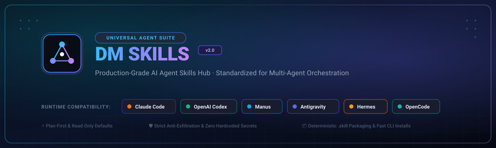

<p align="center">
  
</p>

<p align="center">
  <a href="https://github.com/devdudumuniz/skills"></a>
  <a href="https://github.com/devdudumuniz/skills"></a>
  <a href="./LICENSE"></a>
  <a href="https://github.com/devdudumuniz/skills"></a>
</p>

<p align="center">
  <strong>Hub universal e aberto de competências de engenharia de software para Agentes de IA autônomos.</strong><br>
  Projetado para interoperabilidade nativa em <strong>Claude Code</strong>, <strong>OpenAI Codex</strong>, <strong>Manus</strong>, <strong>Antigravity</strong>, <strong>Hermes</strong>, <strong>OpenCode</strong> e ambientes locais.
</p>

---

## 🌟 Visão Geral

O **DM Skills** é uma suíte padronizada de competências prontas para produção (*production-grade agent skills*) voltada a agentes de inteligência artificial. Cada skill encapsula procedimentos determinísticos, heurísticas de segurança, templates executivos e scripts de verificação que capacitam os agentes a resolver problemas complexos com autonomia e responsabilidade.

### Princípios Fundamentais

- 🛡️ **Plan-First & Read-Only por Padrão:** O agente sempre elabora o plano e audita antes de propor mudanças. Deploys, alterações de firewall, mutações em produção e efeitos externos exigem gates explícitos de autorização.
- 🔒 **Zero Exfiltração e Sem Segredos Hardcoded:** Todas as skills usam referências de variáveis de ambiente (`DM_SECRET_*`), sem caminhos locais fixos nem credenciais embutidas.
- 📦 **Empacotamento Determinístico:** Cada skill pode ser consumida diretamente pelo diretório ou por seu pacote distribuível `.skill` (arquivo ZIP em conformidade com o padrão aberto de *Agent Skills*).
- 🧩 **Multi-Runtime Nativo:** Um único repositório que abastece múltiplos agentes sem necessidade de adaptação manual.

---

## 🤖 Compatibilidade de Runtimes

| Plataforma / Agente | Local de Descoberta Padrão | Método de Instalação |
|---|---|---|
| **Claude Code** (Anthropic) | `~/.claude/skills/<skill>` | `python install.py --agent claude` |
| **OpenAI Codex** | `$CODEX_HOME/skills/<skill>` ou `~/.codex/skills/` | `python install.py --agent codex` |
| **Manus** | Pacote `.skill` importado ou pasta de workspace | `python install.py --agent manus --package` |
| **Antigravity** (Google DeepMind) | `~/.gemini/config/skills/` ou `.agents/skills/` | `python install.py --agent antigravity` |
| **Hermes Agent** | `~/.hermes/skills/<skill>` | `python install.py --agent hermes` |
| **OpenCode** | `~/.opencode/skills/<skill>` | `python install.py --agent opencode` |
| **Projeto Local / Repositório** | `./.skills/<skill>` ou `./.agents/skills/` | `python install.py --agent local` |

---

## 🚀 Como Instalar e Usar

O repositório inclui um instalador universal multiplataforma em Python (`install.py`), sem qualquer dependência externa (funciona em Linux, macOS e Windows):

### 1. Listar todas as skills disponíveis
```bash
python install.py --list
```

### 2. Instalar para um agente específico
```bash
# Para Claude Code
python install.py --agent claude --all

# Para OpenAI Codex (uma skill específica)
python install.py --agent codex --skill exact-ui-extraction-transfer

# Para Antigravity
python install.py --agent antigravity --all

# Para Hermes ou OpenCode
python install.py --agent hermes --all
python install.py --agent opencode --all
```

### 3. Instalar no projeto atual ou pasta customizada
```bash
# Cria uma pasta .skills/ no diretório de trabalho atual
python install.py --agent local

# Ou especifique qualquer diretório de destino
python install.py --dest ./caminho/do/meu-agente/skills
```

### 4. Exportar como pacotes `.skill` (para upload no Manus)
```bash
python install.py --agent manus --package --all
```

---

## 📚 Catálogo de Skills

| Skill | Categoria | Modo de Execução | Descrição |
|---|---|---|---|
| [**devops-delivery**](./devops-delivery/SKILL.md) | `DevOps` | `plan-first` | Planeja e revisa entregas de software cobrindo CI/CD, ambientes, observabilidade, rollback e matriz de risco sem acionar deploy automático. |
| [**vibecode-builder**](./vibecode-builder/SKILL.md) | `Engenharia` | `iterative-tdd` | Converte ideias de produto e demandas informais em implementações verificáveis com escopo delimitado, TDD e UX sólida. |
| [**automation-designer**](./automation-designer/SKILL.md) | `Automação` | `plan-first` | Projeta automações e workflows com gatilhos, idempotência, políticas de retry, timeouts, segredos por referência e observabilidade. |
| [**security-baseline**](./security-baseline/SKILL.md) | `Segurança` | `read-only` | Revisão defensiva de código, dependências e arquitetura contra falhas conhecidas, gerando findings priorizados sem exploração destrutiva. |
| [**network-server-diagnostics**](./network-server-diagnostics/SKILL.md) | `Diagnóstico` | `read-only` | Diagnostica conectividade e integridade de servidores correlacionando DNS, rotas, portas, TLS, serviços e logs sem alterar regras de rede. |
| [**exact-ui-extraction-transfer**](./exact-ui-extraction-transfer/SKILL.md) | `Frontend` | `plan-first` | Extrai geometria, CSS computado, tokens e estados de interfaces autorizadas e reproduz com fidelidade pixel-faithful em Tailwind/React/CSS. |
| [**status-portal**](./status-portal/SKILL.md) | `Governança` | `non-destructive` | Instala um painel moderno e somente leitura de acompanhamento de projetos com fases, gates, backlog, linha do tempo e relatórios executivos em PDF. |
| [**status-portal-registro**](./status-portal-registro/SKILL.md) | `Governança` | `append-only` | Ledger auditável que registra em tempo real sessões, conclusões de tarefas com evidência criptográfica/hash, bloqueios e passagem de bastão. |
| [**status-portal-publicar**](./status-portal-publicar/SKILL.md) | `Governança` | `read-only-publish` | Publica o portal de status com container Docker seguro, proxy reverso, exportação estática e varredura automatizada contra vazamento de dados. |

---

## 🛠️ Estrutura do Repositório

```text
dm-skills/
├── assets/
│   └── banner.svg                  # Banner oficial em vetor para documentação
├── packages/                       # Pacotes compilados .skill prontos para distribuição
│   ├── devops-delivery.skill
│   ├── vibecode-builder.skill
│   ├── automation-designer.skill
│   ├── security-baseline.skill
│   ├── network-server-diagnostics.skill
│   ├── exact-ui-extraction-transfer.skill
│   ├── status-portal.skill
│   ├── status-portal-registro.skill
│   └── status-portal-publicar.skill
├── tools/
│   └── package_skills.py           # Empacotador determinístico de arquivos .skill
├── <skill-name>/                   # Diretório de código-fonte de cada skill
│   ├── SKILL.md                    # Instrução mestra e contrato da skill
│   ├── references/                 # Manuais, playbooks e guias complementares
│   ├── scripts/                    # Scripts utilitários de suporte e auditoria
│   └── templates/                  # Modelos de configuração e dados
├── manifest.json                   # Catálogo canônico legível por máquina (JSON Schema)
├── install.py                      # CLI multiplataforma de instalação universal
├── CONTRIBUTING.md                 # Guia de contribuição e regras de conformidade
├── LICENSE                         # Licença MIT
└── README.md                       # Documentação principal
```

---

## 📦 Gerando e Atualizando Pacotes `.skill`

Caso você crie ou edite alguma skill, pode reconstruir todos os pacotes `.skill` com uma única chamada:

```bash
# Reconstrói todas as skills em packages/
python tools/package_skills.py

# Ou reconstrói uma skill específica
python tools/package_skills.py --skill status-portal
```

---

## 📄 Licença

Este projeto é disponibilizado sob a licença [MIT](./LICENSE). Sinta-se livre para utilizar, distribuir e adaptar em seus próprios agentes de IA.
